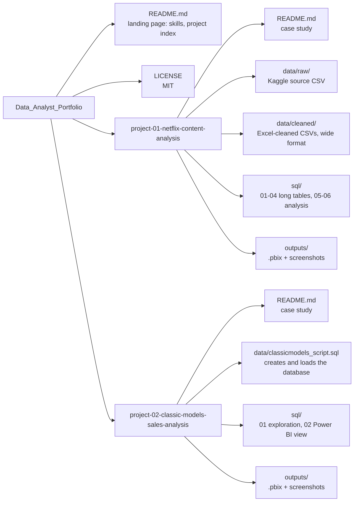
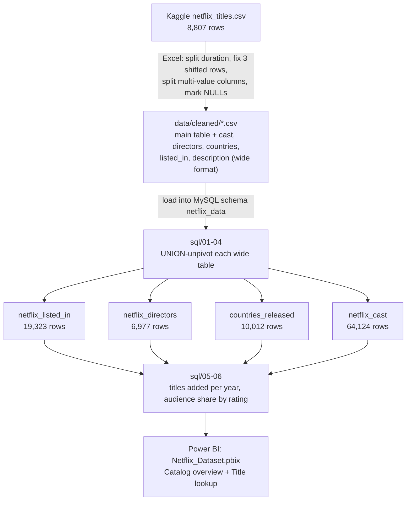
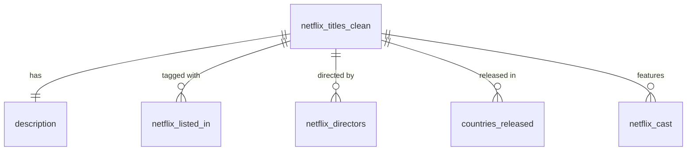
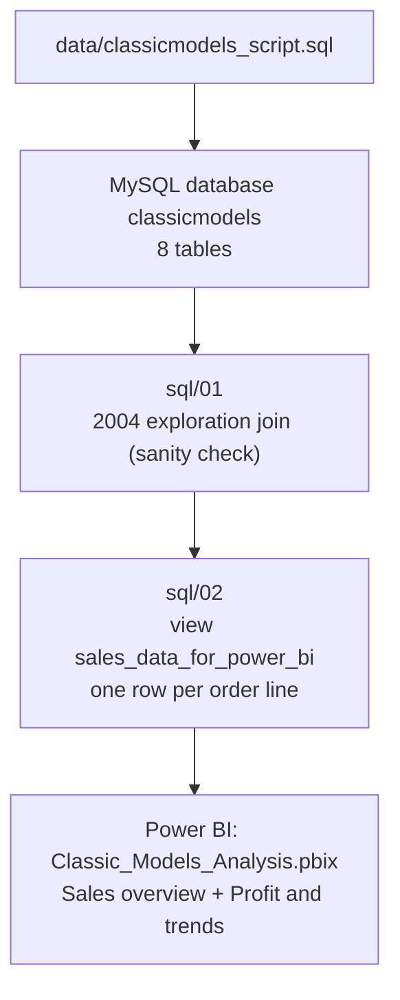
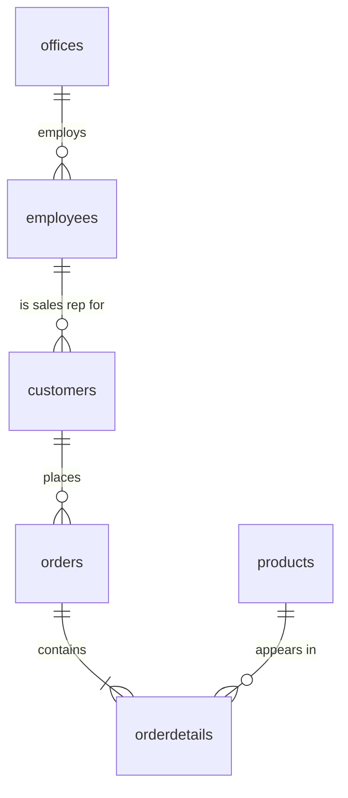

# Systems Overview

How the pieces of this portfolio fit together: the tools, the data flow in each project, and how to rebuild everything from the raw sources.

## 1. Repository at a glance

Each project is self-contained. Nothing is shared between them except the conventions below.

## 2. Technology stack

| Layer | Tool | Role |
|-------|------|------|
| Cleaning | Excel | Split multi-value columns, fix shifted rows, mark `NULL`s (Project 1) |
| Storage / modeling | MySQL | Schemas, unpivoted tables, views (both projects) |
| Presentation | Power BI Desktop | Dashboards, DAX measures, slicers, bookmarks (both projects) |
| Verification | Python (ad hoc) | Independent check of Project 1 row counts |
| Publishing | Git / GitHub | Version control, case-study READMEs, MIT license |

## 3. Project 1: Netflix Content Analysis

**Question:** Which audiences does the catalog serve most heavily, and which genres define each?

### Data flow

### Data model

All tables join on `show_id` (one title row to many rows in each long table).

| Table | Grain | Key columns |
|-------|-------|-------------|
| `netflix_titles_clean` | One row per title | `show_id`, type, title, date added, release year, rating, duration, `Duration_type` |
| `netflix_listed_in` | Title × genre | `show_id`, `category` |
| `netflix_directors` | Title × director | `show_id`, director |
| `countries_released` | Title × country | `show_id`, country |
| `netflix_cast` | Title × cast member | `show_id`, cast member |
| `description` | One row per title | `show_id`, description |

### Key design decisions

- **Wide to long in SQL.** Multi-value fields arrive as numbered columns. `UNION` stacks them and removes duplicates; `WHERE ... IS NOT NULL` drops empty slots.
- **Audience = rating group.** The data has no viewer information, so ratings stand in for intended audience (Adult, Teen, Older kids/Family, All kids).

## 4. Project 2: Classic Models Sales Analysis

**Question:** Where do sales and profit come from, and when?

### Data flow

### Source schema and the view

The view joins six of the eight tables:

| Calculated field | Formula |
|------------------|---------|
| `sales_value` | `quantityOrdered * priceEach` |
| `cost_of_sales` | `quantityOrdered * buyPrice` |

Pulling the sales rep's office gives two geographic cuts: `customer_country` and `office_country`.

### Integrity check

22 of 122 customers have no sales rep, so the inner join to `employees` could drop rows. None of them placed orders, so the view total ($9,604,190.61) equals the raw order-line sum.

### Power BI layer

- **Page 1, Sales overview:** sales by product line, office and customer country; sales vs. cost per product; date and product slicers; a Sales / Net Profit toggle (bookmarks); KPI cards.
- **Page 2, Profit and trends:** decomposition tree (country → product line → customer); monthly table with month-over-month % and year-to-date.
- **DAX measures:** net profit, MoM %, YTD sales, average order value.

## 5. Conventions shared across projects

- **Folder layout:** `data/`, `sql/`, `outputs/`, plus a case-study `README.md`.
- **SQL scripts** are numbered in run order, with a header comment stating the purpose and, where relevant, the expected row counts.
- **Case-study README structure:** summary, business question, data, tools, method, dashboards, findings, recommendations, limitations, how to reproduce.
- **Figures are verified** against the source data before they go in a README.
- **Licensing:** the author's work is MIT; source datasets keep their own licenses and are linked from each project README.

## 6. Reproducing the environment

| Need | Version / note |
|------|----------------|
| MySQL | Any recent MySQL server (schema names: `netflix_data`, `classicmodels`) |
| Power BI Desktop | Free edition; opens the `.pbix` files |
| Excel | Only needed to redo Project 1 cleaning |

**Project 1:** start from `data/raw/netflix_titles.csv`, apply the cleaning steps, load `data/cleaned/` into `netflix_data`, run `sql/01-04`, then open the `.pbix` and point it at `data/cleaned/` if prompted.

**Project 2:** run `data/classicmodels_script.sql`, run `sql/02_create_sales_view_for_power_bi.sql`, then open the `.pbix` and point it at your MySQL server and the view.

## 7. Known limitations of the system

- **Not fully automated.** The Excel cleaning and Power BI steps are manual; only the SQL layer is scriptable.
- **Netflix wide tables are not in the repo as SQL.** The loading of the cleaned CSVs into MySQL is not scripted, so the `01-04` scripts assume the tables already exist (`listed in`, etc.).
- **`.pbix` files are binary** and do not diff in Git; screenshots in `outputs/` are the reviewable record.
- **Project 2 view includes all order statuses**, including cancelled orders (about 2.5% of sales).
- **Datasets are samples or catalogs**, so results illustrate technique rather than describe real businesses.
