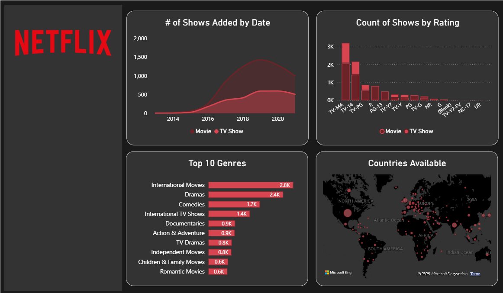
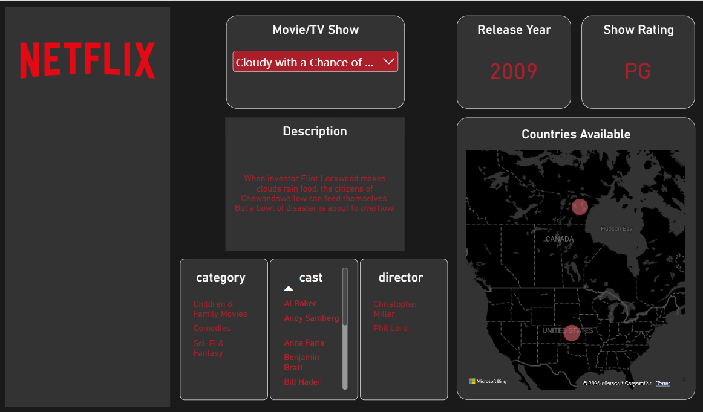

# Netflix Content Analysis

> **Summary:** Cleaned and modeled 8,807 Netflix titles in Excel, then built two Power BI dashboards to show how the catalog breaks down by audience rating, genre, country, and year added, and which genres dominate each audience segment.

## Business question

**Which audiences does Netflix's catalog serve most heavily, and which genres define the content for each audience?**

Netflix has to decide where to invest in new content. This project uses the catalog itself to find out which audience groups (defined by content rating, such as TV-MA or TV-14) have the most titles, which genres lead within each group, and how the mix has changed over time. The goal is to give a content strategy team a starting point for deciding which genres to push for its largest audience segment.

**Scope note:** the dataset describes the *catalog*, not viewers. It has no viewership, subscriber, or age data, so "demographic" here means the *intended audience* signaled by each title's rating. The findings show where the catalog is concentrated, not what people watch. See Limitations.

## Data
- **Source:** [Netflix Movies and TV Shows](https://www.kaggle.com/datasets/shivamb/netflix-shows) by shivamb on Kaggle. See the Kaggle page for the dataset's license and terms.
- **Size:** 8,807 titles, 12 columns, titles added through 2021
- **Raw file:** `data/raw/netflix_titles.csv`

## Tools
Excel (cleaning and restructuring) · MySQL · Power BI (dashboards)

## Data cleaning (Excel)

The raw file stores several attributes as comma-separated lists in a single cell (cast, director, country, genre). That makes them impossible to count or filter properly, so I split the data into a main table plus one table per multi-value field, all linked by `show_id`.

| File | Rows | What it holds |
|------|------|---------------|
| `netflix_titles_clean.csv` | 8,807 | One row per title: type, title, date added, release year, rating, duration |
| `cast.csv` | 8,807 | Up to 50 cast columns per title |
| `directors.csv` | 8,807 | Up to 13 director columns per title |
| `countries.csv` | 8,807 | Up to 12 country columns per title |
| `listed_in.csv` | 8,807 | Up to 3 genre columns per title |
| `description.csv` | 8,807 | Title descriptions, separated from the main table |

Specific steps:
1. **Split `duration`** into a numeric `duration` and a `Duration_type` column (`min`, `Season`, `Seasons`) so runtimes and season counts can be averaged.
2. **Fixed shifted rows:** 3 titles (Louis C.K. specials, `s5542`, `s5795`, `s5814`) had their runtime in the `rating` column and a blank `duration`. Moved the value to `duration`.
3. **Split multi-value columns** (cast, director, country, genre) into one column per value.
4. **Marked missing values** explicitly as `NULL`.
5. **Removed duplicates:** none found (`show_id` is unique in both files).

### Missing data in the raw file
| Field | Missing |
|-------|---------|
| director | 2,634 (30%) |
| country | 831 |
| cast | 825 |
| date_added | 10 |
| rating | 4 |
| duration | 3 |

### Known data issues
- The cast, director, country, and genre CSVs in `data/cleaned/` are in wide format (one column per value). The long-format versions are built in MySQL (see below).

## SQL (MySQL)

The wide Excel tables are hard to count or filter in a BI tool, so I loaded them into a MySQL schema (`netflix_data`) and unpivoted each one into a long table with one row per title and value. Each script stacks the numbered columns with `UNION` and drops empty slots.

| Script | Output table | Rows | Distinct values |
|--------|--------------|-----:|----------------:|
| [`01_create_listed_in_table.sql`](sql/01_create_listed_in_table.sql) | `netflix_listed_in` | 19,323 | 42 genres |
| [`02_create_directors_table.sql`](sql/02_create_directors_table.sql) | `netflix_directors` | 6,977 | 4,992 directors |
| [`03_create_countries_table.sql`](sql/03_create_countries_table.sql) | `countries_released` | 10,012 | 122 countries |
| [`04_create_cast_table.sql`](sql/04_create_cast_table.sql) | `netflix_cast` | 64,124 | 36,430 cast members |

These row counts are what the scripts should produce from the cleaned CSVs; I checked them independently in Python.

**Analysis queries**

| Query | What it answers | Key result |
|-------|-----------------|------------|
| [`05_num_titles_added_per_year.sql`](sql/05_num_titles_added_per_year.sql) | How many movies and TV shows were added each year? | Additions peaked in 2019 (1,424 movies, 592 TV shows); 2021 is a partial year |
| [`06_audience_share_by_rating.sql`](sql/06_audience_share_by_rating.sql) | What share of the catalog does each audience segment hold? | Adult 45.5%, Teen 30.1%, Older kids/Family 16.9%, All kids 6.4% |

## Dashboards (Power BI)

**1. Catalog overview** – titles added over time, titles by rating, top 10 genres, and a map of countries.

**2. Title lookup** – pick any title to see its release year, rating, description, categories, cast, director, and countries on a map.

## Key findings

*Rating groups: Adult = TV-MA/R/NC-17 · Teen = TV-14/PG-13 · Older kids/Family = TV-PG/PG/TV-Y7/TV-Y7-FV · All kids = TV-Y/TV-G/G. 90 titles with no valid rating are excluded from segment figures.*

1. **The catalog skews toward mature audiences.** Adult-rated titles are 46% of the catalog (4,009 titles) and teen-rated titles another 30%. Kids' ratings (TV-Y, TV-G, G) are only 6.5%. TV-MA alone is the largest rating at 36%.
2. **Movies outnumber TV shows about 2.3 to 1** (69.6% vs. 30.4%).
3. **Additions peaked in 2019, then slowed.** 2,016 titles were added in 2019, 1,879 in 2020. 2021 is a partial year (the data ends in September), so it is not directly comparable.
4. **Top genres overall:** International Movies (2,752), Dramas (2,427) and Comedies (1,674). A title can have up to three genres, so counts overlap.
5. **Each segment has a different genre profile.**

| Audience segment | Titles | Top genres (share of segment) |
|------------------|-------:|-------------------------------|
| Adult | 4,009 | International Movies 31% · Dramas 30% · International TV Shows 18% · Comedies 15% |
| Teen | 2,650 | International Movies 42% · Dramas 33% · Comedies 24% · International TV Shows 18% |
| Older kids / Family | 1,490 | Children & Family Movies 28% · Comedies 24% · International Movies 21% |
| All kids | 568 | Kids' TV 39% · Children & Family Movies 35% |

6. **Content comes from 122 countries, but the US dominates.** The US appears on 3,690 titles, then India (1,046) and the UK (806).

## Recommendations

*These are hypotheses to test with viewership data, since the catalog alone can't show demand.*

- **Adult and teen audiences are the largest segments, and Dramas and International Movies lead both.** These genres are where Netflix has the deepest catalog, so they are the natural base for continued investment.
- **Comedies are a bigger share of teen content (24%) than adult content (15%).** That gap may be an opening in the adult segment worth checking against viewing data.
- **Kids' content is the smallest segment (6.5%).** Whether that is under-served or deliberately small depends on viewing and retention data Netflix would have.
- **Next step:** join this catalog view with viewership or subscriber demographics to see which genres each audience actually watches.

## Limitations

- **Catalog is not viewership.** More titles in a genre does not mean more viewers.
- **Ratings are a proxy for audience.** They describe content maturity, not who actually watches.
- **Partial 2021 data** and multi-genre titles (counts overlap) affect trend and genre totals.

## How to reproduce
1. Start from `data/raw/netflix_titles.csv`.
2. Apply the cleaning steps above.
3. Open [`outputs/Netflix_Dataset.pbix`](outputs/Netflix_Dataset.pbix) in Power BI Desktop (free). It contains both dashboard pages. If Power BI asks for the data location, point it at the files in `data/cleaned/`.
