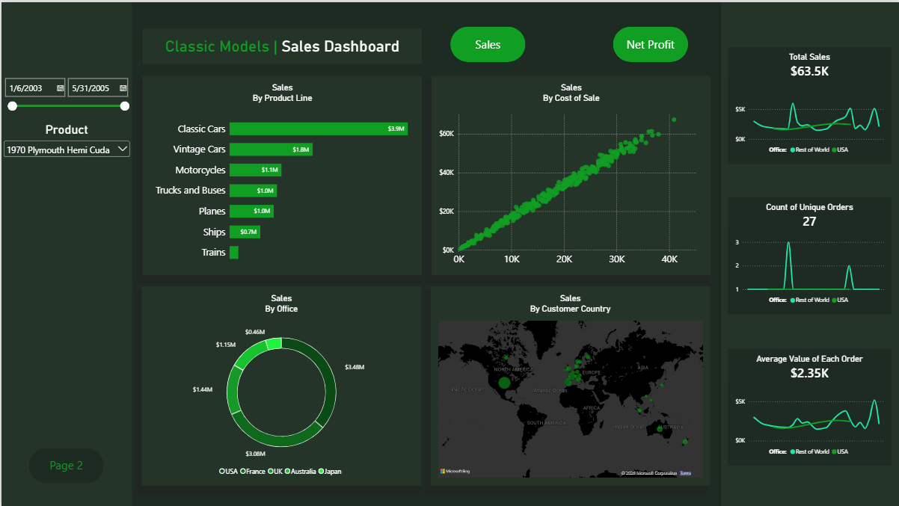
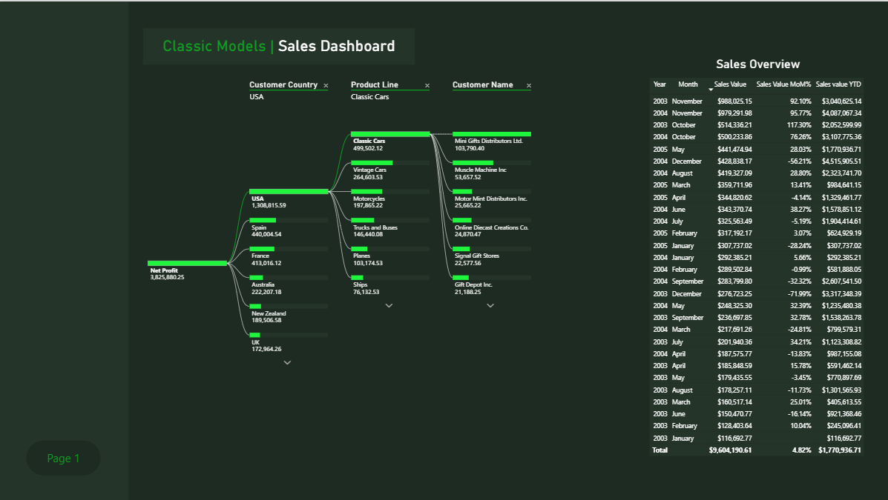

# Classic Models Sales Analysis

> **Summary:** Built a MySQL view over the Classic Models sales database and a two-page Power BI dashboard that shows sales and net profit by product line, sales office, customer country, and month.

## Business question

**Where do Classic Models' sales and profit come from, and when?**

Classic Models is a retailer of scale-model cars and other collectibles. Management needs to know which product lines, markets, and customers drive revenue and profit, and how sales move through the year, so it can decide where to focus inventory, sales effort, and promotions.

## Data

- **Source:** the `classicmodels` sample database from [MySQL Tutorial](https://www.mysqltutorial.org/getting-started-with-mysql/mysql-sample-database/). It covers customers, products, orders, order lines, employees, and offices.
- **Period analyzed:** January 2003 to May 2005
- **Not included in this repo:** the database is freely available at the link above, so I haven't copied it here. To reproduce the work, load it into MySQL first.

## Tools
MySQL (joins, views, calculated fields) · Power BI (dashboards, DAX measures)

## SQL (MySQL)

| Script | Purpose |
|--------|---------|
| [`01_sales_2004_exploration.sql`](sql/01_sales_2004_exploration.sql) | Joins orders, order lines, products, and customers for 2004 to check the data before building the view |
| [`02_create_sales_view_for_power_bi.sql`](sql/02_create_sales_view_for_power_bi.sql) | Creates the view `sales_data_for_power_bi` that feeds the dashboard |

The view joins six tables (orders, order details, customers, products, employees, offices) and adds two calculated fields:
- `sales_value` = quantity ordered × price each
- `cost_of_sales` = quantity ordered × buy price

Pulling in the sales rep's office lets the dashboard split sales by **sales office** as well as by **customer country**.

*Data check:* 22 of the 122 customers have no assigned sales rep, so the view's inner join to `employees` could have dropped orders. None of those customers placed an order, so the view's total ($9,604,190.61) matches the raw sum of order lines exactly.

## Dashboard (Power BI)

**Page 1: Sales overview.** Sales by product line, sales vs. cost of sale per product, sales by office, and sales by customer country. A date range and a product selector filter the page, and the Sales / Net Profit buttons switch the measure. The KPI cards show total sales, unique orders, and average order value.

**Page 2: Profit and trends.** A decomposition tree breaks net profit down by customer country, then product line, then customer. A monthly table shows sales value, month-over-month change, and year-to-date sales.

## Key findings

*Figures cover the full date range (Jan 2003 – May 2005) and were checked against the `classicmodels` database.*

1. **Total sales were $9.60M across 326 orders, and net profit (sales minus cost of sales) was $3.83M,** a 39.8% margin.
2. **Two product lines make up about 59% of sales.** Classic Cars brought in $3.85M (40%) and Vintage Cars $1.80M (19%). Motorcycles ($1.12M), Trucks and Buses ($1.02M), Planes ($0.95M), and Ships ($0.66M) follow, and Trains is the smallest at $0.19M (2%).
3. **Sales peak every November.** November 2003 ($988K) and November 2004 ($979K) are the two biggest months, each roughly double the next-largest month in its year, and October is the next strongest in both years.
4. **Sales are concentrated in two offices.** The USA office handled $3.48M and the France office $3.08M, together about 68% of sales. The UK ($1.44M), Australia ($1.15M), and Japan ($0.46M) offices handled the rest.
5. **US customers are the biggest source of profit.** They generated $1.31M of the $3.83M net profit (34%). Spain ($440K) and France ($413K) follow.
6. **Sales grew year over year.** 2004 sales were $4.52M, up 36% from $3.32M in 2003. 2005 covers only January to May ($1.77M).
7. **Sales and cost of sale move almost in a straight line** at product level, so margin is fairly consistent across products and sales volume is what drives profit.

## Recommendations

*These are based on the dashboard only and should be checked against inventory and campaign data.*

- **Stock and staff for Q4.** Sales peak in October and November every year, so inventory and fulfillment should be ready before then.
- **Protect the two core lines.** Classic and Vintage Cars account for most revenue, so stock-outs there cost the most.
- **Look at the long tail.** Trains and Ships are small. Decide whether they are worth the shelf space or need promotion.
- **Next step:** compare sales to inventory levels to see whether peak months are demand-limited or supply-limited.

## Limitations

- The data is a **sample database**, so the results illustrate the analysis and don't describe a real company.
- **Order status isn't filtered.** The view includes cancelled orders ($239K, about 2.5% of sales) and orders that are on hold, in process, or disputed. Filtering to shipped and resolved orders would give a stricter revenue figure.
- 2005 covers only part of the year (through May), so year-over-year comparisons for 2005 aren't like-for-like.
- Net profit here is sales minus cost of sales only. It leaves out shipping, payroll, and overhead.

## How to reproduce

1. Load the `classicmodels` database into MySQL (link above).
2. Run [`sql/02_create_sales_view_for_power_bi.sql`](sql/02_create_sales_view_for_power_bi.sql) to create the view.
3. Open [`outputs/Classic_Models_Analysis.pbix`](outputs/Classic_Models_Analysis.pbix) in Power BI Desktop (free). If it asks for the data source, point it at your MySQL server and the `sales_data_for_power_bi` view.
